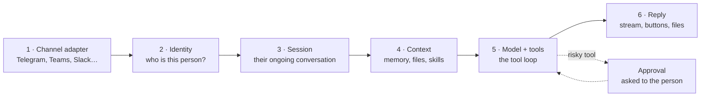

# Donkey 🫏

[](https://github.com/manelsen/donkey/actions/workflows/ci.yml)
[](https://github.com/manelsen/donkey/releases/tag/nightly)
[](https://huggingface.co/spaces/manelmoura/donkey)
[](LICENSE)
[](https://github.com/manelsen/donkey/commits/master)

[](https://nim-lang.org)
[](https://github.com/status-im/nim-chronos)
[](docs/ARCHITECTURE.md)
[](#-development)
[](src/)

[](docs/topics/channels.md)
[](docs/topics/providers.md)
[](#tools-and-what-keeps-them-safe)
[-8A2BE2)](docs/topics/memory.md)
[](https://coderabbit.ai)

> **A self-hosted AI agent for small teams, written in Nim.**
> One native binary on a VPS serves your team on the channels they already
> use, remembers each person across all of them, works with tools under your
> rules, and keeps the bill down.

---

## Contents

1. [What Donkey is](#-what-donkey-is)
2. [The path of one message](#-the-path-of-one-message)
3. [What it can do](#-what-it-can-do)
4. [Getting started](#-getting-started)
5. [Security essentials](#-security-essentials)
6. [Where to read next](#-where-to-read-next)
7. [Development](#-development)

---

## 🫏 What Donkey is

Donkey is a **daemon**: it runs all the time on a server you own and talks to
people through messaging apps (Telegram, Slack, Microsoft Teams, WhatsApp and
fifteen more). Each person gets one identity, one memory and one ongoing
conversation, whichever app they write from: start on Telegram, go on in
Teams, and Donkey knows who you are and what you said.

Behind the conversation sits an agent: a language model of your choice
(Anthropic, OpenAI, Gemini, DeepSeek, a local Ollama and others) with tools
(files, shell in a sandbox, web, GitHub, MCP servers, skills), memory and
scheduling. You stay in charge: risky actions ask first, secrets stay
encrypted on your disk, and the whole instance is managed from a terminal
(`donkey ctl`, `donkey tui`).

Three ideas shape it:

- **Small and sovereign.** One native binary, few dependencies, SQLite
  embedded by default. Your data lives in files and a database on your
  machine.
- **Pure core, replaceable edges.** Hexagonal architecture: the decisions are
  pure functions; channels, providers and storage are adapters behind ports.
  Architecture tests keep it that way.
- **Test first, always.** Every change starts with a failing test.

---

## 🧭 The path of one message

Follow a message from a person to an answer; each step names the part of
Donkey that does it.



1. **A channel adapter receives it.** Each app has its own adapter (long
   polling, webhook, WebSocket). It checks the sender (signatures, DM policy,
   allowlists) and turns the platform's message into Donkey's own format.
2. **Identity resolves the person.** `(channel, account)` maps to one internal
   user. `/mycode` on one app and `/continue <code>` on another join both to
   the same person; new people can go through operator pairing.
3. **The session picks up the conversation.** Sessions belong to the person,
   not to the app. The first message of someone new starts a short onboarding
   (name, timezone, language, the assistant's personality).
4. **Context is gathered.** Relevant memories are recalled from the MAGMA
   graph, attachments are downloaded into the person's paddock, and the
   person's learned skills are offered.
5. **The model works, with tools.** The orchestrator runs the tool loop:
   the model answers or calls tools; tools that can do harm pause for the
   person's approval. A crash in the middle resumes the turn without repeating
   side effects.
6. **The answer goes back** on the same app: streamed where the app allows
   it, with buttons, images and files where it can show them. A reply the app
   refuses waits in a dead-letter queue and is retried.

---

## ✨ What it can do

### Channels: where people talk to it

19 channels, each with its own adapter: **Telegram, Discord, Slack, WhatsApp
(Cloud API), Microsoft Teams, Google Chat, Mattermost, WeCom, WeChat, QQ
(OneBot and official), Feishu, DingTalk, LINE, Matrix, Signal, IRC, SMS
(Twilio), Email and CLI**. Telegram, Discord, WhatsApp and Teams can run
several bots with their own persona (`[[bots]]`), sharing the instance's
people and memory.

| | Telegram | Discord | Slack | Teams | WhatsApp | Mattermost | Others |
|---|:---:|:---:|:---:|:---:|:---:|:---:|:---:|
| Streaming / editable replies | ✅ | ✅ | edits | | | | DingTalk, Matrix |
| Buttons (approvals, menus) | ✅ | ✅ | ✅ | Adaptive Cards | | | QQ, DingTalk |
| Files and images in | ✅ | ✅ | | ✅ | ✅ | ✅ | Google Chat, SMS, WeChat, Feishu, DingTalk, Matrix |
| Files out (`send_file`) | ✅ | ✅ | ✅ | ✅ | ✅ | ✅ | |

The full matrix, generated from the capability registry, is in
[`docs/topics/channels.md`](docs/topics/channels.md).

### Providers: which model thinks

**OpenRouter, Anthropic, OpenAI, DeepSeek, Gemini, MiniMax, ZAI, Groq,
Ollama, OpenCode Go and Zen, NVIDIA, Alibaba, Fireworks, Mistral, Bedrock and
Azure OpenAI**, each with its own adapter that absorbs that API's quirks.
Each person (and each named agent) can choose provider and model; smart
routing can fail over to another eligible provider, and provider health is
tracked. Streaming follows the chosen route. See
[`docs/topics/providers.md`](docs/topics/providers.md).

### Memory: what it remembers

- **MAGMA**, a multi-relational graph per person (memories in time order,
  entities, episodes, commitments, preferences), in embedded **SQLite** by
  default or **PostgreSQL + pgvector** (`-d:withPostgres`).
- **Recall** fuses semantic and lexical search (accents and word prefixes)
  and reads time questions ("what did we decide last week?") as a window.
- **Backtrail** searches older conversations before answering when the
  question calls for it; `search_conversations` lets the agent do it on
  demand.
- **Paddocks**: a readable folder per person with `USER.md`, `MEMORY.md`,
  `PREFERENCES.md`, attachments and session transcripts. With MAGMA the graph
  is the source of truth and the files are its readable export.

See [`docs/topics/memory.md`](docs/topics/memory.md).

### Context and cost: long conversations, paid once

The session history only grows, so the provider's **prompt cache** keeps
reading it instead of billing it again; retrieved context travels with the
turn's message, not in the cached prefix. Past 40% of a 1M-token model's
context (60% of a smaller one) the old part becomes a summary in one step.
Anthropic gets cache markers and adaptive thinking with its thinking blocks
returned intact. Cached tokens show up in usage, traces and `/insights`.

### Tools, and what keeps them safe

- **Built in**: files in the paddock, `bash` in a sandbox, code execution,
  web fetch and search, a browser, images, `send_file`, schedules, a task
  board (`manage_tasks`, `/tasks`), read-only `github` and `git_inspect`.
- **Sandbox**: shell commands run in an OCI container (Docker or Podman) as
  the daemon's user, read-only root and no network by default, or as
  WebAssembly applets under `wasmtime`.
- **Approvals**: risky tools (`bash`, `edit_file`, `rm`, `mv`, `cp` by
  default) ask the person first, with buttons where the app has them; the
  operator can answer too (`donkey ctl approval`).
- **MCP**: servers over stdio or Streamable HTTP, with OAuth login; MCP
  sampling runs only with the person's approval and under token caps
  ([`docs/topics/mcp.md`](docs/topics/mcp.md)).
- **Skills**: Deno skills with explicit `--allow-*` permissions.

### It gets better with use

Donkey learns **skills per person** (`SKILL.md`, behind a guard that blocks
unsafe ones), reviews finished conversations in the background, curates what
it learned, and lets people steer it with `/learn`, `/refine` and
`/insights`. See [`docs/topics/learned-skills.md`](docs/topics/learned-skills.md).

### Agents and automation

- **Named agents**: specialist personas (a reviewer, a researcher) with their
  own role and model, called with `@name`; rooms put several in one
  conversation. Local agents are strict by default: their data does not
  leave the machine.
- **Sub-agents** for delegated work, **schedules** (cron, interval, once) and
  a **heartbeat** that runs a checklist and sends reminders on the person's
  channel.

### Reliable by construction

- **Every HTTP request has a deadline** for the whole exchange (connection,
  headers, each read), over BearSSL with certificate checks.
- **Turns survive a crash**: a journal in `state/turns/` resumes them without
  repeating side effects; no tool call can hold the loop.
- **Dead letters**: replies a channel refused are kept and retried
  (`donkey ctl deliveries`).

### Operating it

- `donkey ctl` manages users, pairings, approvals, secrets, tools, memory,
  providers and deliveries; `donkey tui` does the same in a terminal UI, with
  traces and provider health.
- Metrics and **per-turn traces** to a file or **OpenTelemetry**.
- An **OpenAI-compatible endpoint** (`/v1/chat/completions`) runs the real
  agent turn for other programs; see [`docs/topics/interfaces.md`](docs/topics/interfaces.md).

---

## 🚀 Getting started

**You need:** a Linux or macOS machine, one channel token (for example
`TELEGRAM_BOT_TOKEN`) and one provider key (or a local Ollama). Docker or
Podman is recommended for the shell sandbox.

### 1. Get the binary

On a server, take the nightly build of `master` (x86_64 Linux, glibc 2.28+):

```bash
bash deploy/update.sh            # downloads, checks the checksum, installs, restarts
bash deploy/update.sh --rollback # back to the previous binary
```

Or build it ([Nim 2.4.2](https://nim-lang.org/install.html) and Nimble):

```bash
git clone https://github.com/manelsen/donkey.git && cd donkey
nimble build                      # SQLite embedded by default
```

### 2. Set it up

```bash
./donkey setup                    # config, state, sandbox runtime, keys
./donkey ctl secret set OPENROUTER_API_KEY   # keys go to the encrypted vault
./donkey ctl provider test anthropic
```

### 3. Run it

```bash
./donkey start                    # foreground
./donkey service install && ./donkey service start   # systemd user service
./donkey doctor                   # health check
```

Write to your bot. The first message starts the onboarding.

The longer guide is [`docs/quickstart.md`](docs/quickstart.md); every setting
is in [`docs/reference/configuration.md`](docs/reference/configuration.md).

---

## 🔐 Security essentials

- **Secrets**: `donkey ctl secret` stores keys encrypted with AES-256-GCM in
  `{home}/.secrets/`, with the key kept apart (`{home}/.secret_key`, 0600).
  Never pass a secret as a command-line argument
  ([`docs/topics/secrets.md`](docs/topics/secrets.md)).
- **Who may talk to it**: DM policy (`open`, allowlist or operator
  `pairing`), group allowlists, revocation with `donkey ctl user revoke`.
- **The HTTP gateway** listens on `127.0.0.1:8080`. Its data routes need
  `DONKEY_HTTP_TOKEN`; binding beyond loopback requires the token and an
  explicit `DONKEY_HTTP_ALLOW_INSECURE=1`, because it speaks plain HTTP: put
  a TLS reverse proxy in front. Webhooks can terminate TLS themselves
  (`DONKEY_WEBHOOK_TLS_CERT` / `_KEY`).
- **Outbound web** checks every redirect against private and reserved
  addresses; on a server, add a firewall rule or a filtering proxy
  (`DONKEY_WEB_PROXY`).
- **Third-party code**: MCP servers run on the host with the daemon's
  environment, and any tool output can carry prompt injection. Install only
  what you trust; the threat model is in [`CLAUDE.md`](CLAUDE.md#threat-model--skills-de-terceiros).

The deployment checklist is [`docs/hardening.md`](docs/hardening.md).

---

## 📚 Where to read next

| To… | Read |
|---|---|
| Understand the concepts | [`docs/getting_started/basic_concepts.md`](docs/getting_started/basic_concepts.md) |
| See the architecture | [`docs/ARCHITECTURE.md`](docs/ARCHITECTURE.md) |
| Set up a channel | [`docs/topics/channels.md`](docs/topics/channels.md) |
| Choose providers and routing | [`docs/topics/providers.md`](docs/topics/providers.md) |
| Learn how memory works | [`docs/topics/memory.md`](docs/topics/memory.md) |
| Use files and media | [`docs/topics/media.md`](docs/topics/media.md) |
| Schedule things | [`docs/topics/schedules.md`](docs/topics/schedules.md) |
| Use named agents | [`docs/topics/named-agents.md`](docs/topics/named-agents.md) |
| Look up the chat commands | [`docs/topics/commands.md`](docs/topics/commands.md) |
| Call it from other programs | [`docs/topics/interfaces.md`](docs/topics/interfaces.md) |
| Connect MCP servers | [`docs/topics/mcp.md`](docs/topics/mcp.md) |
| Keep secrets | [`docs/topics/secrets.md`](docs/topics/secrets.md) |
| Run and compare the tests | [`docs/testing.md`](docs/testing.md) |
| Harden a deployment | [`docs/hardening.md`](docs/hardening.md) |
| See what comes next | [`docs/ROADMAP.md`](docs/ROADMAP.md) |

---

## 🧪 Development

```
src/donkey/
  domain/    pure business logic (func), no I/O, no exceptions
  core/      pure infrastructure: types, parsers, routing, tool loop
  ports/     the contracts: concepts and closure objects
  app/       use cases: sessions, orchestrator, gateway (Chronos)
  adapters/  the I/O edge: channels, providers, memory, HTTP, secrets
  infra/     sandbox, queues, threads
```

The rules are enforced, not hoped for: fallible I/O returns `Result`
(no exceptions past an adapter), `domain/` stays pure, `app/` reaches files
and processes only through ports, and the environment is read once. Each rule
has a test under `tests/architecture/`.

```bash
bash scripts/run_tests.sh                 # the whole suite, grouped compilation
bash scripts/run_tests.sh tests/ports     # one folder or one file
bash scripts/check_boundaries.sh          # layer imports (needs ripgrep)
```

Comparing two runs and the grouped runner's numbers are in
[`docs/testing.md`](docs/testing.md).

Work is **test first**: a failing test, the code that makes it pass, then the
refactor. Pull requests get an automated review and must pass CI. The
conventions are in [`CLAUDE.md`](CLAUDE.md).

---

## 📄 License

[MIT](LICENSE).
