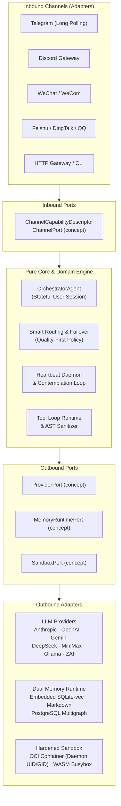

# Donkey 🫏

[](https://github.com/manelsen/donkey/actions/workflows/ci.yml)
[](https://github.com/manelsen/donkey/actions/workflows/sync-to-hub.yml)
[](https://coderabbit.ai)
[](https://nim-lang.org)
[](docs/ARCHITECTURE.md)
[](LICENSE)

> **A sovereign, ultra-lightweight autonomous AI agent daemon written in pure Nim.**  
> Built for long-running deployments on a VPS, homelab, laptop, or container with Chronos async I/O, strict hexagonal boundaries, sovereign dual-layer memory, and hardened sandboxing.

---

## ⚡ Why Donkey?

Most AI agent platforms are heavy, complex webs of Python interpreters, gigabyte-sized virtualenvs, and unpredictable Node runtimes. **Donkey takes the opposite path:**

- **Native Binary & Low Footprint**: Compiles to a compact native binary with deterministic ARC/ORC memory management (requires host OpenSSL libraries for HTTPS). Idles in single-digit megabytes of RAM.
- **Strict Hexagonal Architecture**: Business logic, planning, and memory algorithms remain 100% pure and decoupled from I/O through Nim structural typing (`concept`). Adapters can be plugged in or replaced without touching core code.
- **Sovereign Dual-Layer Memory (MAGMA)**: Out-of-the-box SQLite with embedded `sqlite-vec` vector similarity search, alongside human-inspectable Markdown paddocks (`USER.md`, `MEMORY.md`, `HEARTBEAT.md`). Scales seamlessly to PostgreSQL + `pgvector` multigraph when required.
- **Hardened Execution Sandbox**: Shell execution can be isolated via an OCI container runtime (Docker/Podman) running under the daemon UID/GID with read-only rootfs, plus fast POSIX file manipulation via `wasmtime` subprocess applet dispatch (requires host subprocess execution support).
- **Autonomous Heartbeat & Contemplation**: Runs background scheduling loops that inspect checklists in `HEARTBEAT.md`, digest conversation memories into episodic journals, and deliver pro-active reminders across connected channels.
- **Multi-Channel & Multi-Provider**: Direct, first-class connectivity to Telegram, Discord, WeChat, Feishu, DingTalk, Slack, QQ, and Matrix, with active session routing for Anthropic, Gemini, MiniMax, ZAI, and OpenRouter (sessions selecting OpenAI, DeepSeek, or Ollama are currently mapped to ZAI coding by `buildProviderSpec`). Smart routing can try eligible providers on failure. For users without provider preferences, the setup wizard selects a fixed provider; OpenRouter is a fallback only when its key is configured.

---

## 📐 Architecture

Donkey is engineered according to strict **Hexagonal Architecture (Ports and Adapters)** principles. Dependencies only flow inwards toward pure domain models.



See [docs/ARCHITECTURE.md](docs/ARCHITECTURE.md) for the complete architectural specification.

---

## 🚀 Quickstart in 60 Seconds

### Prerequisites

- [Nim 2.2+](https://nim-lang.org/install.html) with Nimble (`choosenim` recommended)
- `ripgrep` (`rg`) for architectural boundary verification
- `docker` or `podman` (required for default OCI shell sandbox)
- `TELEGRAM_BOT_TOKEN` (required to start the daemon) and at least one directly supported session provider key: Anthropic, OpenAI, DeepSeek, Gemini, MiniMax, ZAI, Groq, OpenRouter, or a local Ollama instance

### 1. Build the Binary

```bash
# Build development binary (embedded SQLite + sqlite-vec enabled by default)
nimble build

# Or compile optimized, stripped release binary (install dependencies first)
nimble install -y -d
# Linux (GNU linker with --gc-sections; on macOS, use -Wl,-dead_strip instead):
nim c -d:release --opt:size \
  --passC:"-ffunction-sections -fdata-sections" \
  --passL:"-Wl,--gc-sections" \
  -o:donkey src/donkey.nim
strip donkey
```

### 2. Guided Setup

Run the interactive setup wizard to initialize configuration templates and state directories:

```bash
./donkey setup
```

The wizard configures `~/.config/donkey/donkey.toml`, provisions the state store in `~/.donkey/`, selects the available OCI sandbox runtime, and saves provider keys. Verify provider connectivity with `./donkey ctl provider test <name>`.

### 3. Start the Daemon

> [!IMPORTANT]
> The embedded HTTP gateway listens on `0.0.0.0:8080` by default, exposing `/api/status`, `/api/logs`, `/api/events`, and `/api/chat` without authentication (`/api/chat` accepts inbound messages with an optional `userId` and can create or dispatch to sessions if the user is not revoked, while `/api/events` streams live logs). Block direct external access to port 8080 with a firewall on any deployment where this port is accessible, and enforce authentication at the proxy layer if using a reverse proxy. On shared multi-user hosts, unprivileged local users can also connect directly to port 8080 and bypass proxy authentication; isolate network access strictly to the proxy process (e.g., via network namespaces) or disable the gateway entirely. Any `DONKEY_HTTP_PORT` variable already exported in the shell environment takes precedence over `.env` files; to reliably disable the gateway, run `DONKEY_HTTP_PORT=0 ./donkey start` or set `DONKEY_HTTP_PORT=0` in the environment file loaded by the daemon. Note that the daemon resolves `donkey.env` before loading `donkey.toml` by checking `$DONKEY_HOME/donkey.env` (defaulting to `~/.donkey/donkey.env`) and falling back to `~/.config/donkey/donkey.env`; placing `DONKEY_HTTP_PORT=0` only in a custom `home` path configured inside TOML will not take effect. Preserve existing credentials in the loaded file and unset any inherited shell variable (`unset DONKEY_HTTP_PORT`) before starting. For systemd, set it in the service's effective `EnvironmentFile` such as `~/.config/donkey/donkey.env` and restart.
>
> Even on a single-user host, a malicious web page can read `/api/logs` or inject messages into `/api/chat` (including via simple `text/plain` requests without CORS preflight, creating or invoking sessions for arbitrary non-revoked users) if the browser permits local network access. Isolate the gateway from the browser (e.g., via network namespaces) or disable it; blocking external firewall access alone is not sufficient.

```bash
./donkey start
```

Run as a systemd background user service:

```bash
./donkey service install
./donkey service start
```

Verify instance health anytime:

```bash
./donkey doctor
```

---

## 🧠 Sovereign Memory: The Paddock System

Every user interacting with Donkey receives an isolated, human-readable directory called a **Paddock** located at `~/.donkey/paddocks/<user-id>/`:

```text
~/.donkey/paddocks/<uuid>/
├── USER.md          # User profile & instructions (MAGMA graph profile takes precedence)
├── PREFERENCES.md   # Model overrides, language, timezone (graph preferences take precedence; update via /models <provider> <model>)
├── HEARTBEAT.md     # Active checklist of background autonomous tasks
├── MEMORY.md        # Episodic reflections & long-term conversational memory
├── CONTACTS.md      # Social graph, relations, and mentions
├── solutions/       # Self-indexed technical solutions & code recipes
├── sessions/        # Session transcripts & turn summaries
└── .secrets/        # User-encrypted API keys & tokens (AES-GCM via nimcrypto)
```

### The MAGMA Subsystem
1. **SQLite-First (Default)**: Embedded SQLite and `sqlite-vec` vector similarity search are compiled directly into the binary. Episodic memories, user preferences, and knowledge nodes live in `~/.donkey/state/magma.sqlite`. Profile texts, preferences, and memories are transmitted to OpenRouter to generate embeddings during writes and queries when embedding generation is active (e.g. via `OPENROUTER_API_KEY`); CLI operations like `ctl memory search` and `ctl memory import` may also transmit queries and non-empty context externally. Other configured services, such as Z.AI or external rerankers, may also transmit queries and candidate memory texts. Raw conversation transcripts are preserved in JSONL session files under `paddocks/<uuid>/sessions/`.
2. **Markdown Bootstrap & Export**: Markdown paddocks serve as the human-readable view, bootstrap source, and debug format. When MAGMA is active, runtime writes prioritize the graph. If opening or migrating the database raises an exception, `newMagmaAdapter` returns `nil`, and runtime profile or preference writes can fail when accessing the adapter before the `MdFileAdapter` Markdown fallback takes place. If a write propagates a catchable error, `MdFileAdapter` attempts to record the update in the paddock Markdown files. Some SQLite write errors are swallowed, so updates can be lost without a Markdown fallback. `loadContext` will prioritize graph content once MAGMA recovers. Before running `./donkey ctl memory export <uuid> [output_dir]`, back up and reconcile any paddock Markdown files that diverged during outages, as exporting will overwrite the target directory with the current MAGMA view (or omit `output_dir` to print to stdout). Note that `./donkey ctl memory import <uuid>` reads context before calling `deleteUser`; non-empty graph fields take precedence over divergent edits in Markdown files (only empty graph fields are populated from Markdown), and unexported nodes or relation edges (episodes, solutions) are permanently purged without recovering divergent file edits. Always take a full database backup before importing.
3. **PostgreSQL Multigraph Scaling**: For multi-agent graph querying at scale, Donkey supports PostgreSQL + `pgvector`. Ensure the `pgvector` extension is installed on your PostgreSQL server and that the database user configured in `DONKEY_PG_DSN` has permissions to execute `CREATE EXTENSION IF NOT EXISTS vector`. Install the `libpq` client development library on the build host first (for example, `libpq-dev` on Debian/Ubuntu). Compile with `nim c -d:withPostgres -u:withSqlite -o:donkey src/donkey.nim` and configure `DONKEY_PG_DSN`. Recompiling does not automatically transfer existing data from SQLite; operators must back up their database and migrate existing nodes and edges before switching backends (`./donkey ctl memory export <uuid>` exports only the three context Markdown files for an individual user, not the complete knowledge graph).

---

## 🛡️ Sandboxing & Tool Security

Donkey provides sandboxing for shell execution. MCP servers run directly on the host and inherit the daemon environment, which may contain credentials; install only trusted MCP servers, or isolate them externally. With `--dev-mode`, the default sandbox mode runs shell commands directly on the host. If `sandbox.allow_host_fallback = true` (allowed only in `--dev-mode`), certain OCI failures can also execute commands on the host; do not rely on container isolation in those configurations.

- **OCI Hardened Sandbox**: Shell executions normally run inside ephemeral Docker or Podman containers configured with:
  - Host daemon UID and GID matching (prevents host file ownership pollution)
  - Read-only root filesystem (`read_only_rootfs = true`)
  - Network access disabled by default (enabling network in donkey.toml requires --dev-mode)
  - Isolated temporary and paddock mounts
- **WASM Applet Dispatch**: Fast execution of POSIX applets (cat, grep, sed, find) via `wasmtime` and `~/.donkey/busybox`.
- **Model Context Protocol (MCP)**: Native client support for external MCP tool servers:
  ```bash
  # Positional arguments only via CLI
  ./donkey ctl tool install <mcp-server-command> [positional-args...]
  ```
  > [!TIP]
  > Server flags like `--port=8000` are filtered out by the CLI option parser; configure MCP servers requiring flags directly in `tools.toml` under your configured home directory (`cfg.home/tools.toml`, which defaults to `~/.donkey/tools.toml`).

---

## 🌐 Supported Ecosystem

### Channels (Inbound)

| Channel | Mode | Features |
|:---|:---|:---|
| **Telegram** | Long Polling | Streaming responses, markdown formatting, reactions, inline keyboards |
| **Discord** | Gateway WebSockets | Slash commands, components, thread handling, bot mentions |
| **WeChat / WeCom**| Webhook / Event loop | Enterprise WeChat & personal bridge support |
| **Feishu / Lark** | Webhook + API | Events API at `/webhook/feishu`, verification token + optional `FEISHU_ENCRYPT_KEY` (AES-256-CBC), DM gate; interactive cards not supported |
| **DingTalk** | Outbound API | Inbound requires an integration that calls `pushEvent` |
| **QQ / OneBot** | WebSocket / HTTP | OneBot v11 protocol, group and private chat dispatch |
| **Slack** | Webhook + API | Events API, Slash Commands and Interactivity at `/webhook/slack`; requires `SLACK_BOT_TOKEN`, `SLACK_SIGNING_SECRET` and `DONKEY_WEBHOOK_PORT`. DM gate and outbound `chat.postMessage` |
| **Matrix** | Outbound PUT | Inbound requires an integration that calls `pushEvent` |
| **HTTP Gateway**| REST / SSE | Local webhooks; note: open `/api/events` streams occupy the single accept thread (blocking concurrent `/api/chat` or status calls for up to 5h until disconnected) |

> **Slack inbound setup:** point Event Subscriptions, Slash Commands and Interactivity to the same `https://<public-host>/webhook/slack` URL. The receiver listens on `DONKEY_WEBHOOK_HOST:DONKEY_WEBHOOK_PORT` (default `127.0.0.1`) over HTTP, so expose it through an HTTPS reverse proxy; Slack does not call a loopback HTTP endpoint directly.

> **Feishu inbound setup:** set `FEISHU_APP_ID`, `FEISHU_VERIFICATION_TOKEN` and `DONKEY_WEBHOOK_PORT` (the receiver is disabled while the port is unset); optionally set `FEISHU_ENCRYPT_KEY` for AES-256-CBC payload encryption. Point Event Subscriptions to `https://<public-host>/webhook/feishu` and forward it through an HTTPS reverse proxy to `DONKEY_WEBHOOK_HOST:DONKEY_WEBHOOK_PORT` (default host `127.0.0.1`).

### DM pairing

Set `dm_policy = "pairing"` under `[security]` (or `DONKEY_DM_POLICY=pairing`) to require operator approval for new DM senders:

1. The unknown user sends `/pair`; the daemon stores a pending request with a 6-digit code.
2. The operator lists requests with `./donkey ctl pair list`.
3. The operator approves with `./donkey ctl pair approve <code>` (or rejects with `./donkey ctl pair reject <code>`).

Approval mints the identity UUID and writes it to `state/dm_allowlist.txt`; the user's next message is accepted. Requests expire after 10 minutes and are rate-limited to one request per identity per minute.

### Providers (Outbound)

| Provider | Default Tool Support | Streaming | Recommended Models |
|:---|:---:|:---:|:---|
| **Anthropic** | ✅ | ✅ | `claude-opus-5-5`, `claude-sonnet-5-5`, `claude-fable-5-2` |
| **OpenAI** | ✅ | ✅ | `gpt-6-astra`, `gpt-6.1-sol`, `gpt-6.1-terra`, `gpt-6-luna` |
| **DeepSeek** | ✅ | ✅ | `deepseek-v4-pro`, `deepseek-4.1-flash` |
| **Gemini** | ✅ | ❌ | `gemini-4-argon`, `gemini-3.1-pro`, `gemini-3.8-flash` |
| **Ollama** | ✅ | ✅ | `llama4:scout`, `llama3.3:70b`, `qwen2.5-coder:32b` |
| **MiniMax** | ✅ | ❌ | `MiniMax-Text-01`, `MiniMax-M2` |
| **ZAI / Zhipu** | ✅ | ❌ | `glm-5.1`, `glm-5`, `glm-4.7` |
| **OpenRouter** | ✅ | ✅ | Universal routing fallback |

> [!NOTE]
> In the daemon runtime, sessions receive the global OpenRouter `streamFn` when `OPENROUTER_API_KEY` is configured. In addition, the orchestrator tool loop only engages streaming when zero tools are present; because sessions register native tools by default, responses are executed through complete turns rather than token streams. Adapter-level streaming flags in the table indicate `buildProviderBundle` support (`zai-anthropic` also provides streaming).

---

## 🛠️ CLI Reference

The `donkey ctl` utility provides complete instance governance:

```bash
# User and Paddock management
./donkey ctl user list
./donkey ctl user show <uuid>
./donkey ctl memory export <uuid> [output_dir]

# Tool and Extension management
./donkey ctl tool install <mcp-command> [args...]
./donkey ctl skill install <name> <script.ts>

# Provider Diagnostics
./donkey ctl provider test anthropic
./donkey ctl provider test gemini
```

---

## 🧪 Development & Quality Assurance

Donkey follows disciplined Test-Driven Development (TDD) with strict architectural boundaries.

### Running Tests

```bash
# Run the default test suite in parallel across all CPU cores
bash scripts/run_tests.sh

# Target a specific module or test file
bash scripts/run_tests.sh tests/ports
bash scripts/run_tests.sh tests/app/t_orchestrator.nim

# Execute via Nimble
nimble test
```

> [!NOTE]
> `scripts/run_tests.sh` always skips `t_sqlite_store`, even when targeted directly (`withSqlite` is enabled by default in `config.nims`). Run this suite directly:
>
> ```bash
> nim c --hints:off --mm:orc -u:withPostgres -r tests/adapters/memory/t_sqlite_store.nim
> ```
>
> PostgreSQL/Age tests and in-process wasm3 (`t_wasm.nim`) are excluded by default in `scripts/run_tests.sh`. WASM applet and shell composer suites run automatically when `~/.donkey/busybox` and `wasmtime` are present on the host.

### Verifying Architectural Boundaries

Core and Domain modules must never import Adapters. Run the automated boundary checker:

```bash
# Requires ripgrep (rg)
bash scripts/check_boundaries.sh
```

---

## 📄 License

Donkey is open-source software licensed under the [MIT License](LICENSE).
