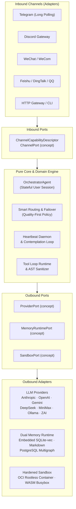

# Donkey 🫏

[](https://github.com/manelsen/donkey/actions/workflows/ci.yml)
[](https://github.com/manelsen/donkey/actions/workflows/sync-to-hub.yml)
[](https://coderabbit.ai)
[](https://nim-lang.org)
[](docs/ARCHITECTURE.md)
[](LICENSE)

> **A sovereign, ultra-lightweight autonomous AI agent daemon written in pure Nim.**  
> Built for long-running deployments on a VPS, homelab, laptop, or container with Chronos async I/O, strict hexagonal boundaries, sovereign dual-layer memory, and hardened sandboxing.

---

## ⚡ Why Donkey?

Most AI agent platforms are heavy, complex webs of Python interpreters, gigabyte-sized virtualenvs, and unpredictable Node runtimes. **Donkey takes the opposite path:**

- **Native Binary & Low Footprint**: Compiles to a single, compact static binary with deterministic ARC/ORC memory management. Idles in single-digit megabytes of RAM.
- **Strict Hexagonal Architecture**: Business logic, planning, and memory algorithms remain 100% pure and decoupled from I/O through Nim structural typing (`concept`). Adapters can be plugged in or replaced without touching core code.
- **Sovereign Dual-Layer Memory (MAGMA)**: Out-of-the-box SQLite with embedded `sqlite-vec` vector similarity search, alongside human-inspectable Markdown paddocks (`USER.md`, `MEMORY.md`, `HEARTBEAT.md`). Scales seamlessly to PostgreSQL + `pgvector` multigraph when required.
- **Hardened Execution Sandbox**: Untrusted tool execution is safely isolated via an OCI container runtime (Docker/Podman) running under the daemon UID/GID with read-only rootfs, plus in-process WASM applet dispatch for fast, secure file manipulation.
- **Autonomous Heartbeat & Contemplation**: Runs background scheduling loops that inspect checklists in `HEARTBEAT.md`, digest conversation memories into episodic journals, and deliver pro-active reminders across connected channels.
- **Multi-Channel & Multi-Provider**: Direct, first-class connectivity to Telegram, Discord, WeChat, Feishu, DingTalk, Slack, QQ, and Matrix, with resilient failover between Anthropic, OpenAI, DeepSeek, Gemini, MiniMax, Ollama, ZAI, and OpenRouter.

---

## 📐 Architecture

Donkey is engineered according to strict **Hexagonal Architecture (Ports and Adapters)** principles. Dependencies only flow inwards toward pure domain models.



See [docs/ARCHITECTURE.md](docs/ARCHITECTURE.md) for the complete architectural specification.

---

## 🚀 Quickstart in 60 Seconds

### Prerequisites

- [Nim 2.2+](https://nim-lang.org/install.html) with Nimble (`choosenim` recommended)
- `ripgrep` (`rg`) for architectural boundary verification
- `docker` or `podman` (recommended for hardened OCI shell sandbox)
- At least one channel token (e.g., `TELEGRAM_BOT_TOKEN`) and one provider key

### 1. Build the Binary

```bash
# Build development binary (embedded SQLite + sqlite-vec enabled by default)
nimble build

# Or compile optimized, stripped release binary
nim c -d:release --opt:size \
  --passC:"-ffunction-sections -fdata-sections" \
  --passL:"-Wl,--gc-sections" \
  -o:donkey_release src/donkey.nim
strip donkey_release
```

### 2. Guided Setup

Run the interactive setup wizard to initialize configuration templates and state directories:

```bash
./donkey setup
```

The wizard configures `~/.config/donkey/donkey.toml`, provisions the state store in `~/.donkey/`, selects the available OCI sandbox runtime, and verifies provider keys.

### 3. Start the Daemon

```bash
./donkey start
```

Run as a systemd background user service:

```bash
./donkey service install
./donkey service start
```

Verify instance health anytime:

```bash
./donkey doctor
```

---

## 🧠 Sovereign Memory: The Paddock System

Every user interacting with Donkey receives an isolated, human-readable directory called a **Paddock** located at `~/.donkey/paddocks/<user-id>/`:

```text
~/.donkey/paddocks/<uuid>/
├── USER.md          # User profile & instructions (reread before every turn)
├── PREFERENCES.md   # Model overrides, language, timezone, personality (TOML)
├── HEARTBEAT.md     # Active checklist of background autonomous tasks
├── MEMORY.md        # Episodic reflections & long-term conversational memory
├── CONTACTS.md      # Social graph, relations, and mentions
├── solutions/       # Self-indexed technical solutions & code recipes
├── sessions/        # Session transcripts & turn summaries
└── .secrets/        # User-encrypted API keys & tokens (AES-GCM via nimcrypto)
```

### The MAGMA Subsystem
1. **SQLite-First (Default)**: SQLite and `sqlite-vec` vector embeddings are compiled directly into the Donkey binary. Zero external database daemon needed.
2. **Markdown Bootstrap & Fallback**: Conversations continuously synchronize with Markdown files, providing direct visibility, git compatibility, and manual editing.
3. **Multigraph Scaling**: When `DONKEY_PG_DSN` is configured, Donkey activates PostgreSQL + `pgvector` for enterprise multi-agent graph querying.

---

## 🛡️ Sandboxing & Tool Security

Donkey never executes untrusted commands directly on your host:

- **OCI Hardened Sandbox**: Shell executions run inside ephemeral Docker or Podman containers configured with:
  - Host daemon UID and GID matching (prevents host file ownership pollution)
  - Read-only root filesystem (`read_only_rootfs = true`)
  - Network isolation togglable per user/task
  - Strict resource quotas (CPU limits, memory capping, timeout killswitches)
- **WASM Applet Dispatch**: High-speed, in-process execution of POSIX applets (cat, grep, sed, find) via sandboxed WebAssembly execution.
- **Model Context Protocol (MCP)**: Native client support for external MCP tool servers:
  ```bash
  ./donkey ctl tool install <mcp-server-command> [args...]
  ```

---

## 🌐 Supported Ecosystem

### Channels (Inbound)

| Channel | Mode | Features |
|:---|:---|:---|
| **Telegram** | Long Polling | Streaming responses, markdown formatting, reactions, inline keyboards |
| **Discord** | Gateway WebSockets | Slash commands, components, thread handling, bot mentions |
| **WeChat / WeCom**| Webhook / Event loop | Enterprise WeChat & personal bridge support |
| **Feishu / Lark** | Webhook / Event stream | Interactive cards, group chats, direct messages |
| **DingTalk** | Stream / Webhook | Corporate notifications, card callbacks |
| **QQ / OneBot** | WebSocket / HTTP | OneBot v11 protocol, group and private chat dispatch |
| **Slack** | Socket Mode / Webhook | Channel mentions, thread continuation |
| **Matrix** | Async sync engine | Decentralized rooms, end-to-end encrypted sessions |
| **HTTP Gateway**| REST / SSE | Local webhooks, chat completions endpoint |

### Providers (Outbound)

| Provider | Default Tool Support | Streaming | Recommended Models |
|:---|:---:|:---:|:---|
| **Anthropic** | ✅ | ✅ | `claude-3-7-sonnet`, `claude-3-5-haiku` |
| **OpenAI** | ✅ | ✅ | `gpt-4o`, `gpt-4o-mini`, `o3-mini` |
| **DeepSeek** | ✅ | ✅ | `deepseek-chat`, `deepseek-reasoner` |
| **Gemini** | ✅ | ✅ | `gemini-2.0-flash`, `gemini-2.5-pro` |
| **Ollama** | ✅ | ✅ | `qwen2.5-coder:32b`, `llama3.3:70b` |
| **MiniMax** | ✅ | ✅ | `MiniMax-Text-01`, `MiniMax-M2` |
| **ZAI / Zhipu** | ✅ | ✅ | `glm-4-plus`, `glm-4-flash` |
| **OpenRouter** | ✅ | ✅ | Universal routing fallback |

---

## 🛠️ CLI Reference

The `donkey ctl` utility provides complete instance governance:

```bash
# User and Paddock management
./donkey ctl user list
./donkey ctl user show <uuid>
./donkey ctl memory export <uuid>

# Tool and Extension management
./donkey ctl tool install <mcp-command> [args...]
./donkey ctl skill install <deno-script.ts> [--allow-net ...]

# Provider Diagnostics
./donkey ctl provider test anthropic
./donkey ctl provider test deepseek
```

---

## 🧪 Development & Quality Assurance

Donkey follows disciplined Test-Driven Development (TDD) with strict architectural boundaries.

### Running Tests

```bash
# Run the default test suite in parallel across all CPU cores
bash scripts/run_tests.sh

# Target a specific module or test file
bash scripts/run_tests.sh tests/ports
bash scripts/run_tests.sh tests/app/t_orchestrator.nim

# Execute via Nimble
nimble test
```

> [!NOTE]
> Opt-in backends requiring active databases (PostgreSQL/Age) are excluded by default. WASM and shell suites run automatically when `~/.donkey/busybox` and `wasmtime` are present on the host.

### Verifying Architectural Boundaries

Core and Domain modules must never import Adapters. Run the automated boundary checker:

```bash
# Requires ripgrep (rg)
bash scripts/check_boundaries.sh
```

---

## 📄 License

Donkey is open-source software licensed under the [MIT License](LICENSE).
