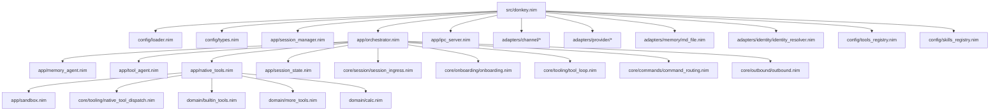
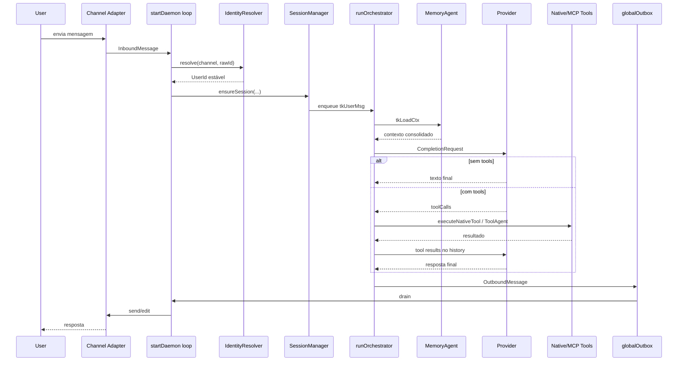
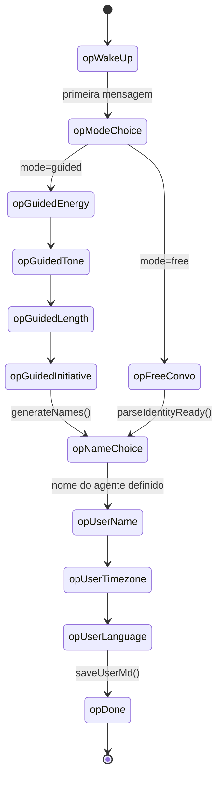
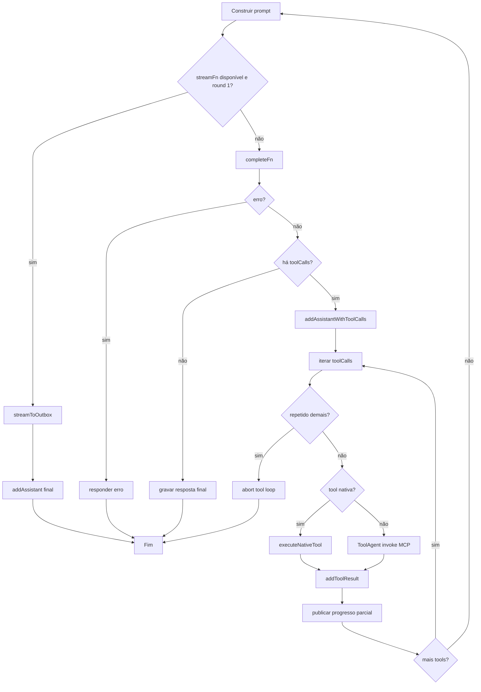
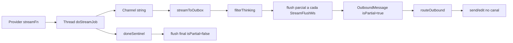
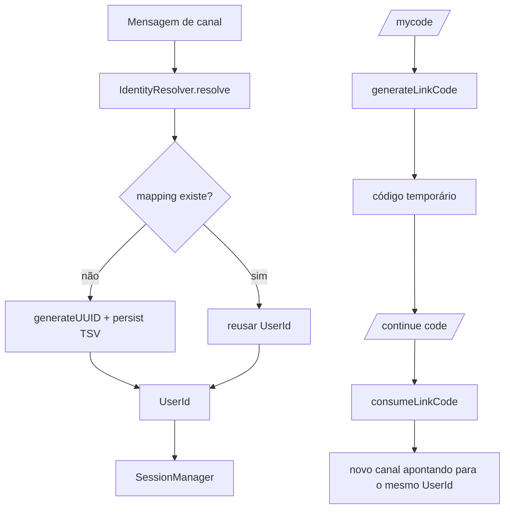
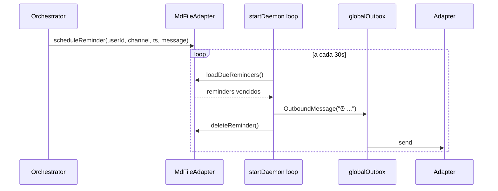
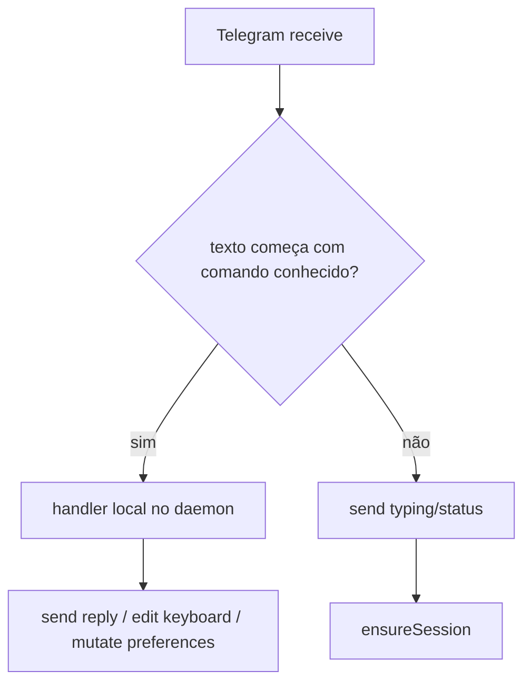

# SPEC — Mapeamento Estrutural do Donkey

Este documento descreve o esqueleto funcional do diretório `src/` do projeto Donkey, com foco em:

- pontos de entrada;
- módulos e responsabilidades;
- esqueletos explícitos das funções centrais;
- fluxos de execução em Mermaid;
- contratos entre daemon, sessões, orquestrador, memória, tools e canais.

Baseado no estado atual do código em `src/donkey.nim` e `src/donkey/**`.

## 0. Boundary Status

O refactor de boundaries foi concluído neste ciclo.

- `core/session/*`: ingresso de sessão
- `core/onboarding/*`: onboarding
- `core/tooling/*`: tool loop e dispatch nativo
- `core/outbound/*`: decisão de outbound/stream
- `core/commands/*`: parse e roteamento semântico de comandos

`app/*` permanece como shell de runtime, consumindo `ports/*` e aplicando efeitos.

## 1. Visão Geral

O Donkey é um daemon em Nim que:

- recebe mensagens de canais como Telegram, Discord, WeCom e Feishu;
- resolve identidade cross-channel para um `UserId` estável;
- mantém uma sessão por usuário via `SessionManager`;
- cria um `runOrchestrator` por sessão;
- usa memória baseada em arquivos Markdown por usuário;
- chama providers LLM;
- executa tools nativas e MCP;
- publica respostas via um `globalOutbox`.

## 2. Topologia de Módulos



## 3. Mapa de Responsabilidades

### 3.1 Entry point

- `src/donkey.nim`
  - CLI (`main`)
  - comandos `ctl` e `service`
  - bootstrap do daemon (`startDaemon`)
  - wiring de adapters, providers, registries e IPC
  - polling dos canais
  - roteamento de saída (`routeOutbound`)
  - criação de sessões (`ensureSession`)

### 3.2 Application layer

- `app/orchestrator.nim`
  - ator por sessão
  - debounce de mensagens
  - carregamento de contexto
  - turn loop com LLM
  - streaming parcial
  - aplicação de decisões de `core/onboarding/*` e `core/tooling/*`

- `app/memory_agent.nim`
  - worker para `loadCtx`, `saveMem`, `savePrefs`

- `app/tool_agent.nim`
  - worker para invocação MCP/Deno

- `app/native_tools.nim`
  - tools embutidas
  - shell, busca, fetch, web search, mermaid, imagem, todo, task e coordenação

- `app/session_manager.nim`
  - lifecycle de sessão por `UserId`

- `app/session_state.nim`
  - estado mutável da sessão
  - todos, checkpoints e jobs

### 3.3 Core layer

- `core/session/session_ingress.nim`
  - decisão pura de sessão nova, reuse, rebuild e redireção para `askInbox`

- `core/onboarding/onboarding.nim`
  - estado e reducers puros do onboarding

- `core/tooling/tool_loop.nim`
  - decisão do loop de tools, repetição, finalização e batch planning

- `core/tooling/native_tool_dispatch.nim`
  - classificação pura das tools nativas por categoria

- `core/outbound/outbound.nim`
  - decisão de stream/create/edit/suppress/cleanup

- `core/commands/command_routing.nim`
  - parse semântico de comandos e callbacks

### 3.4 Domain layer

- `domain/message.nim`
  - tipos de conversa e montagem de `CompletionRequest`

- `domain/agent_message.nim`
  - protocolo interno entre atores

- `domain/personality.nim`
  - onboarding de personalidade
  - prompt builder e parsing de identidade

- `domain/reminder.nim`
  - parsing de horário para reminders

- `domain/builtin_tools.nim`, `domain/more_tools.nim`, `domain/calc.nim`
  - schemas e utilitários das tools

### 3.5 Adapters

- `adapters/channel/*`
  - integração com Telegram, Discord, WeCom, Feishu

- `adapters/provider/*`
  - wrappers de providers LLM

- `adapters/memory/md_file.nim`
  - memória e arquivos do paddock

- `adapters/identity/identity_resolver.nim`
  - mapeamento `(canal, rawId) -> UserId`

## 4. Estruturas de Dados Centrais

### 4.1 Mensagens de conversa

Arquivo: `src/donkey/domain/message.nim`

```text
ChatMessage
  role
  text
  imageUrl
  toolCalls
  toolCallId

ConversationHistory = seq[ChatMessage]

InboundMessage
  userId
  channelId
  text
  mediaUrl
  channel

OutboundMessage
  userId
  text
  replyTo
  channel
  streamId
  isPartial
  mediaUrl
  keyboard

CompletionRequest
  system
  messages
  maxTokens
  tools

CompletionResponse
  text
  inputTokens
  outputTokens
  toolCalls
```

### 4.2 Barramento interno de atores

Arquivo: `src/donkey/domain/agent_message.nim`

```text
AgentMessageKind
  amkTask | amkCancel | amkResult | amkError

TaskKind
  tkUserMsg
  tkReset
  tkLoadCtx
  tkSaveMem
  tkSavePrefs
  tkInvokeTool
  tkDebugToggle
  tkPersonalityChoice
  tkNameChoice
```

### 4.3 Sessão

Arquivo: `src/donkey/app/session_manager.nim`

```text
SessionEntry
  inbox
  channels

SessionManager
  entries: Table[string, SessionEntry]
```

### 4.4 Estado interno da sessão

Arquivo: `src/donkey/app/session_state.nim`

```text
SessionState
  todos
  checkpoints
  jobs
  jobCounter
```

## 5. Esqueletos Explícitos das Funções Centrais

Esta seção não replica o código literalmente; ela resume a estrutura operacional real de cada função.

### 5.1 `main`

Arquivo: `src/donkey.nim`

```text
proc main
  parse getopt()
  resolve configPath
  cfg = loadConfig(configPath)
  ringInit()
  enableHumanLog() se stderr for tty
  log = newLogger("donkey")

  if comando começa com ctl:
    dispatch para ctl user/session/tool/skill/provider/memory/status
    quit

  if comando == tui:
    conecta IPC e abre dashboard
    quit

  if comando == service:
    dispatch install/remove/start/stop/restart/logs
    quit

  caminho padrão:
    log startup
    waitFor startDaemon(cfg, log)
```

### 5.2 `startDaemon`

Arquivo: `src/donkey.nim`

```text
proc startDaemon(cfg, log)
  validar TELEGRAM_BOT_TOKEN
  carregar tokens/credenciais de canais
  memory = MdFileAdapter(...)
  identityPath = cfg.home / "identities.tsv"

  inicializar adapters:
    Telegram
    Discord
    WeCom
    Feishu

  se Discord habilitado:
    startGateway()
    registerSlashCommands()

  se WeCom habilitado:
    startWebhook()

  se Feishu habilitado:
    startGateway()

  tgAdapter.setMyCommands()

  carregar tools e skills globais:
    loadToolRegistry()
    loadSkillRegistry()
    para cada entry:
      build client
      listTools()
      materializar ToolDescription

  construir provider global fallback:
    OpenRouter -> globalCompleteFn/globalStreamFn

  criar:
    globalOutbox
    SessionManager
    tabelas streamMsgIds/statusMsgIds/kbdMsgIds
    IPC server
    searchFn opcional (Postgres)

  loop infinito:
    1. drenar globalOutbox e routeOutbound()
    2. drenar eventos Discord
    3. drenar eventos WeCom
    4. drenar eventos Feishu
    5. poll Telegram
       - tratar comandos locais
       - ou ensureSession(...)
    6. disparar reminders vencidos
    7. sleepAsync(100ms)
```

### 5.3 `ensureSession`

Arquivo: `src/donkey.nim`

```text
proc ensureSession(sm, msg, memory, completeFn, streamFn, toolClients, tools, ...)
  isNew = not sm.hasSession(msg.userId)
  entry = sm.getOrCreate(msg.userId)

  se sessão é nova:
    ctx = memory.loadContext(userId)
    primary = buildCompleteFn(ctx.preferencesMd)
    fallbackFn = buildFallbackFn(primary, @[completeFn])

    sessionClients = toolClients
    sessionTools = tools

    carregar skills por usuário em paddocks/<uid>/skills
    anexar tools nativas

    provLabel = providerLabelFromPrefs(ctx.preferencesMd)

    asyncSpawn runOrchestrator(
      entry.inbox,
      globalOutbox,
      memory,
      fallbackFn,
      streamFn,
      sessionClients,
      sessionTools,
      ...
    )

  sm.recordChannel(userId, channel, channelId)
  gerar msgId sequencial
  empacotar payload
    se há mediaUrl -> JSON {text, mediaUrl}
    senão -> texto puro
  enqueue tkUserMsg no inbox da sessão
```

### 5.4 `routeOutbound`

Arquivo: `src/donkey.nim`

```text
proc routeOutbound(msg, tgAdapter, dcAdapter, wcAdapter, fsAdapter, ...)
  se msg.streamId vazio:
    send normal no adapter do canal
    return

  se streamId já existe:
    editar mensagem existente no canal
  senão:
    enviar primeira mensagem parcial
    guardar message id em streamMsgIds

  se msg.isPartial == false:
    remover streamId da tabela
```

### 5.5 `runOrchestrator`

Arquivo: `src/donkey/app/orchestrator.nim`

```text
proc runOrchestrator(inbox, globalOutbox, memory, completeFn, streamFn, clients, tools, ...)
  criar memInbox, toolInbox, workerOut
  asyncSpawn runMemoryAgent(...)
  asyncSpawn runToolAgent(...)

  inicializar:
    history
    debugMode
    state = newSessionState()
    sessionId
    onboarding state
    identidade do agente
    turnSeq

  loop infinito:
    msg = await collectWithDebounce(inbox, DebounceWindowMs)

    case msg.kind
      amkCancel:
        salvar sessão
        cancelar workers
        break

      amkTask:
        construir NativeCtx

        if tkReset:
          salvar sessão
          limpar history
          responder
          continue

        if tkDebugToggle:
          alternar debugMode
          responder
          continue

        if tkPersonalityChoice:
          avançar onboarding guiado
          talvez gerar nomes
          responder
          continue

        if tkNameChoice:
          persistir identidade do agente
          avançar onboarding do usuário
          responder
          continue

        if taskKind != tkUserMsg:
          continue

        se usuário ainda não tem perfil:
          executar máquina de onboarding
          continue

        carregar identidade do agente se ainda não carregada
        montar system prompt com personalidade + tools

        pedir contexto ao MemoryAgent
        normalizar payload texto/imagem
        adicionar mensagem ao history
        iniciar typing loop

        round = 0
        while not done and round < MaxToolRoundsOrch:
          req = buildPrompt(...)

          se streamFn disponível e round == 1:
            finalText = streamToOutbox(...)
            history.addAssistant(finalText)
            done = true
            continue

          resp = completeFn(req)
          se erro:
            responder erro
            done = true
            continue

          se não há toolCalls:
            salvar resposta final no history
            finalText = r.text
            done = true
            continue

          registrar assistant turn com toolCalls
          para cada toolCall:
            aplicar guard de repetição
            executar:
              schedule_reminder no próprio orquestrador
              senão executeNativeTool()
              senão ToolAgent/MCP
            addToolResult()
            publicar embed parcial de progresso

        encerrar typing loop
        fechar embed de progresso

        se excedeu rounds:
          responder erro
        elif modo não-streaming:
          responder finalText
```

### 5.6 `collectWithDebounce`

Arquivo: `src/donkey/app/orchestrator.nim`

```text
proc collectWithDebounce(inbox, windowMs)
  first = await inbox.get()
  se first.kind != amkTask:
    return first

  texts = @[first.payload]
  latest = first

  loop:
    nextFut = inbox.get()
    se withTimeout(nextFut, windowMs) falhar:
      break
    next = nextFut.read()
    se next.kind == amkCancel:
      return next
    se next.kind == amkTask:
      acumular payload
      latest = next

  latest.payload = join(texts, "\n\n")
  return latest
```

### 5.7 `streamToOutbox`

Arquivo: `src/donkey/app/orchestrator.nim`

```text
proc streamToOutbox(fn, req, outbox, userId, channel, replyTo, streamId)
  abrir Channel[string]
  createThread(doStreamJob)

  accumulated = ""
  lastFlush = nowMs()

  loop:
    drenar tokens disponíveis do channel
    se receber doneSentinel:
      flush final isPartial=false
      joinThread
      return accumulated

    se tempo de flush passou:
      publicar OutboundMessage isPartial=true

    sleepAsync(30ms)
```

### 5.8 `runMemoryAgent`

Arquivo: `src/donkey/app/memory_agent.nim`

```text
proc runMemoryAgent(inbox, outbox, memory, searchFn)
  loop:
    msg = await inbox.get()
    case msg.kind
      amkCancel:
        break

      amkTask:
        case msg.taskKind
          tkLoadCtx:
            ctx = memory.loadContext(userId)
            se searchFn disponível e payload não vazio:
              trocar MEMORY.md por semantic hits
            outbox <- newResultMsg(id, userMd + memory + preferences)

          tkSaveMem:
            appendMemory()
            outbox <- ok

          tkSavePrefs:
            savePreferences()
            outbox <- ok

          else:
            outbox <- error
```

### 5.9 `runToolAgent`

Arquivo: `src/donkey/app/tool_agent.nim`

```text
proc runToolAgent(inbox, outbox, clients)
  loop:
    msg = await inbox.get()
    case msg.kind
      amkCancel:
        break

      amkTask:
        validar tkInvokeTool
        parse payload JSON {name, id, inputJson}
        construir ToolCall
        tentar clients em ordem
        primeiro sucesso -> outbox result
        nenhum client conhece -> outbox result "tool not found"
```

### 5.10 `executeNativeTool`

Arquivo: `src/donkey/app/native_tools.nim`

```text
proc executeNativeTool(tc, ctx, state, history)
  j = parse tc.inputJson

  case tc.name
    ReminderToolName:
      handled = false

    CurrentTimeToolName:
      return currentTimeResult()

    WebFetchToolName:
      return performFetch()

    BashToolName:
      validar command
      return sandboxBash()

    HashlineToolName:
      validar paddock
      return performHashline()

    FindToolName:
      resolver path no paddock
      return performFind()

    GrepToolName:
      resolver path no paddock
      return performGrep()

    FetchToolName:
      return performFetch()

    WebSearchToolName:
      return performWebSearch()

    CalcToolName:
      return evalCalc()

    RenderMermaidToolName:
      return performRenderMermaid()

    InspectImageToolName:
      return performInspectImage()

    AskToolName:
      publicar pergunta ao usuário
      aguardar próximo item do inbox da sessão
      retornar reply.payload

    TodoWriteToolName:
      aplicar ops no SessionState

    CheckpointToolName:
      marcar checkpointNow = true

    RewindToolName:
      restaurar snapshot em newHistory

    TaskToolName:
      return performTask()

    SubmitResult / ReportFinding / CancelJob / Await:
      operar sobre jobs da sessão

    else:
      handled = false
```

### 5.11 `MdFileAdapter`

Arquivo: `src/donkey/adapters/memory/md_file.nim`

```text
hasProfile(userId)
  existe USER.md?

loadContext(userId)
  ler USER.md, MEMORY.md, PREFERENCES.md
  devolver UserContext

saveUserMd(userId, content)
  ensurePaddock()
  write USER.md

appendMemory(userId, text)
  ensurePaddock()
  append lógico em MEMORY.md

savePreferences(userId, content)
  ensurePaddock()
  write PREFERENCES.md

saveSession(userId, sessionId, history)
  se history >= 2:
    serializar JSONL em paddock/sessions/<sessionId>.jsonl

saveIdentity(userId, traits, name)
  merge em PREFERENCES.md:
    agent_name
    agent_energy
    agent_tone
    agent_length
    agent_initiative

loadIdentity(userId)
  parse PREFERENCES.md
  devolver (name, traits)

scheduleReminder(userId, channel, scheduledAt, message)
  escrever reminders/<id>.json

loadDueReminders()
  varrer paddocks
  retornar reminders vencidos
```

### 5.12 `IdentityResolver`

Arquivo: `src/donkey/adapters/identity/identity_resolver.nim`

```text
newIdentityResolver(path)
  carregar TSV existente
  montar store e reverseMap

resolve(kind, rawId)
  key = "kind:rawId"
  se key não existe:
    gerar UUID
    persistir
  return uuid

reverseChannel(userId, kind)
  procurar key "kind:*" em reverseMap

generateLinkCode(userId)
  gerar código de 6 chars
  salvar com TTL de 10 min

consumeLinkCode(code, kind, rawId)
  validar existência e expiração
  mapear novo canal para userId existente
  persistir
```

## 6. Fluxos de Runtime

### 6.1 Fluxo principal de mensagem



### 6.2 Fluxo de onboarding



### 6.3 Tool loop do orquestrador



### 6.4 Streaming parcial



### 6.5 Resolução de identidade cross-channel



### 6.6 Reminders



## 7. Fluxo dos Comandos Locais do Telegram

Os comandos abaixo são tratados diretamente no loop do daemon, sem passar pelo LLM:

- `/start`
- `/help`
- `/mycode`
- `/continue <code>`
- `/forget`
- `/doctor`
- `/memory`
- `/models`
- `/callback ...`
- `/ping`
- `/think`
- `/status`
- `/debug`
- `/reset`

Resumo:



## 8. Contratos Internos Importantes

### 8.1 Persistência por usuário

Paddock base:

```text
{cfg.paddocks}/{userId}/
  USER.md
  MEMORY.md
  PREFERENCES.md
  sessions/
    <sessionId>.jsonl
  reminders/
    <reminderId>.json
  skills/
    ...
```

### 8.2 Garantias operacionais observadas no código

- há uma sessão ativa por `UserId`;
- o daemon centraliza toda saída em `globalOutbox`;
- o orquestrador é o dono do `history` da sessão;
- tools nativas são resolvidas antes de MCP;
- `schedule_reminder` é exceção e permanece no orquestrador;
- streaming faz `send -> edit -> edit -> finalize`;
- o `SessionManager` não persiste sessões, só as mantém em memória;
- a identidade cross-channel persiste em TSV;
- o contexto de memória é síncrono, encapsulado via worker actor.

## 9. Pontos de Atenção Arquitetural

- `startDaemon` concentra muito comportamento: bootstrap, polling, comandos locais, providers, IPC, reminders e routing.
- `runOrchestrator` acumula várias responsabilidades: onboarding, prompt building, tool loop, streaming, typing loop e integração de memória.
- `AskToolName` consome diretamente `ctx.inbox.get()`, então compete com o mesmo inbox da sessão.
- `workerOut` é compartilhado por `MemoryAgent` e `ToolAgent`; o fluxo atual assume ordem sequencial e acoplamento controlado.
- `schedule_reminder` ainda é tratado fora de `native_tools.nim`, embora o nome da tool já esteja lá.
- o caminho do paddock é reconstruído no orquestrador com `~/.donkey/paddocks/<uid>`, enquanto o adapter de memória usa `cfg.paddocks`; isso merece alinhamento para evitar divergência de diretório.

## 10. Índice Rápido por Arquivo

- `src/donkey.nim`: daemon, CLI, sessões, routing, comandos e bootstrap.
- `src/donkey/app/orchestrator.nim`: coração da sessão.
- `src/donkey/app/native_tools.nim`: tool runtime nativo.
- `src/donkey/app/memory_agent.nim`: acesso assíncrono a contexto.
- `src/donkey/app/tool_agent.nim`: invocação MCP.
- `src/donkey/app/session_manager.nim`: tabela de sessões.
- `src/donkey/app/session_state.nim`: todos/checkpoints/jobs.
- `src/donkey/adapters/memory/md_file.nim`: armazenamento Markdown.
- `src/donkey/adapters/identity/identity_resolver.nim`: identidade persistente.
- `src/donkey/domain/message.nim`: tipos de prompt/history.
- `src/donkey/domain/agent_message.nim`: protocolo entre atores.
