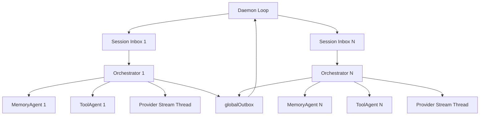
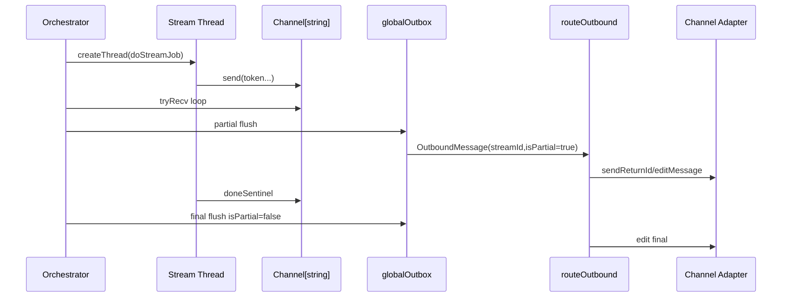

# SPEC_RUNTIME — Contratos, Invariantes e Riscos do Runtime

Este documento descreve o comportamento operacional do runtime do Donkey como ele existe hoje no código.

Foco:

- contratos explícitos e implícitos;
- ownership de estado;
- fronteiras entre componentes;
- invariantes de execução;
- semântica de falha, cancelamento e streaming;
- riscos de evolução e pontos onde a implementação diverge do contrato aparente.

Baseado principalmente em:

- `src/donkey.nim`
- `src/donkey/app/orchestrator.nim`
- `src/donkey/app/native_tools.nim`
- `src/donkey/app/memory_agent.nim`
- `src/donkey/app/tool_agent.nim`
- `src/donkey/adapters/memory/md_file.nim`
- `src/donkey/adapters/identity/identity_resolver.nim`
- `src/donkey/app/ipc_server.nim`

## 1. Modelo Operacional

O runtime é um daemon assíncrono, dirigido por polling/eventos, com uma arquitetura híbrida:

- um loop central no daemon;
- uma sessão por `UserId`;
- um orquestrador assíncrono por sessão;
- dois workers por sessão (`MemoryAgent`, `ToolAgent`);
- adapters síncronos nas bordas;
- streaming LLM feito em thread separada;
- persistência local em arquivos Markdown e JSON.

## 2. Unidades de Runtime

### 2.1 Daemon

Owner: `startDaemon`

Responsabilidades:

- bootstrap de adapters;
- bootstrap de tools/skills globais;
- criação de `globalOutbox`;
- criação do `SessionManager`;
- polling dos canais;
- dispatch de comandos locais;
- roteamento de saída;
- agendamento de reminders vencidos;
- exposição de status/logs via IPC.

Contrato:

- existe exatamente um loop central do daemon por processo;
- toda resposta ao usuário sai por `globalOutbox` ou por resposta imediata do próprio daemon;
- o daemon não mantém o histórico da conversa; isso pertence ao orquestrador.

### 2.2 Sessão

Owner: `SessionManager` + `runOrchestrator`

Responsabilidades:

- associar um `UserId` a um inbox dedicado;
- registrar canais já usados por aquele usuário;
- encapsular o histórico, estado mutável e workers.

Contrato:

- uma sessão é indexada por `string(UserId)`;
- o `SessionManager` mantém o estado quente em memória; apenas metadados do
  registro de sessão (canais, último inbound, session id, assinatura de runtime)
  são persistidos de forma best-effort em `$DONKEY_HOME/state/sessions.json`;
- o histórico da conversa continua owned pelo orquestrador e só é salvo nos
  caminhos já existentes (`amkCancel`, `tkReset`);
- após um restart, entradas restauradas forçam um rebuild do runtime no próximo
  inbound (não existe ator vivo durante o boot).

### 2.3 Orquestrador

Owner: `runOrchestrator`

Responsabilidades:

- debounce;
- onboarding;
- composição de prompt;
- chamada ao provider;
- execução de tools;
- typing loop;
- streaming parcial;
- persistência da sessão no cancelamento e no reset.

Contrato:

- o `history` da sessão é owned exclusivamente pelo orquestrador;
- o `SessionState` também é owned exclusivamente pelo orquestrador;
- `MemoryAgent` e `ToolAgent` são workers subordinados ao orquestrador, não peers autônomos.

### 2.4 Workers

`MemoryAgent`:

- serializa acesso a `loadContext`, `appendMemory`, `savePreferences`;
- opcionalmente enriquece contexto com busca semântica.

`ToolAgent`:

- tenta clients MCP/Deno em ordem;
- devolve o primeiro resultado bem-sucedido.

Contrato:

- ambos consomem `AgentMessage` e respondem em `workerOut`;
- o desenho assume uso sequencial suficientemente ordenado pelo orquestrador.

## 2.5 Fronteiras de Camada

O runtime atual já está bem mais fatiado do que antes, mas ainda não reflete integralmente a separação `Core` / `Ports` / `Adapters` / `Shell`.

Classificação operacional atual:

- `Core`
  - `src/donkey/domain/message.nim`
  - `src/donkey/domain/agent_message.nim`
  - `src/donkey/domain/personality.nim`
  - `src/donkey/domain/reminder.nim`
  - `src/donkey/domain/calc.nim`
  - `src/donkey/domain/builtin_tools.nim`
  - `src/donkey/domain/more_tools.nim`
  - `src/donkey/app/session_state.nim`
  - `src/donkey/core/types.nim`
  - `src/donkey/core/pipeops.nim`
  - `src/donkey/core/session/*`
  - `src/donkey/core/onboarding/*`
  - `src/donkey/core/tooling/*`
  - `src/donkey/core/outbound/*`
  - `src/donkey/core/commands/*`
- `Ports`
  - `src/donkey/ports/provider.nim`
  - `src/donkey/ports/tool.nim`
  - `src/donkey/ports/memory.nim`
  - `src/donkey/ports/channel.nim`
  - `src/donkey/ports/http.nim`
  - `src/donkey/ports/secrets.nim`
  - `src/donkey/ports/embedding.nim`
- `Adapters`
  - `src/donkey/adapters/*`
  - `src/donkey/tui/dashboard.nim`
  - `src/donkey/app/ipc_server.nim`
- `Shell / Mixed`
  - `src/donkey.nim`
  - `src/donkey/app/orchestrator.nim`
  - `src/donkey/app/session_bootstrap.nim`
  - `src/donkey/app/outbound_runtime.nim`
  - `src/donkey/app/native_tools.nim`
  - `src/donkey/app/memory_agent.nim`
  - `src/donkey/app/tool_agent.nim`
  - `src/donkey/app/session_manager.nim`
  - `src/donkey/config/*`

Estado atual da boundary:

- decisões de ingresso, onboarding, tool loop, outbound, command routing e classificação nativa já moram em `core/*`
- `app/*` passou a consumir `ports/*` em vez de adapters concretos
- o enforcement de imports proibidos está em `scripts/check_boundaries.sh` e `tests/architecture/t_boundaries.nim`

Fronteiras-alvo:

- `Core` não deve conhecer `AsyncQueue`, `Thread`, `JsonNode`, adapters concretos, SDKs de canal, TOML, HTTP nem processos.
- `Ports` não devem importar `adapters/*` nem `app/*`.
- `Adapters` não devem conter decisão de onboarding, tool loop, rebuild de sessão nem semântica cross-channel.
- `Shell` deve aplicar decisões e lifecycle, não acumular reducers/deciders puros longos.

Módulos que ainda misturam regra e efeito de forma estrutural:

- `src/donkey/app/orchestrator.nim`
- `src/donkey/app/session_bootstrap.nim`
- `src/donkey/app/outbound_runtime.nim`
- `src/donkey/app/native_tools.nim`

Inventário detalhado e mapa `atual -> alvo`:

- [`BOUNDARY_MAP.md`](./BOUNDARY_MAP.md)

## 3. Ownership de Estado

### 3.1 Estado do processo

Owned pelo daemon:

- `SessionManager`
- `globalOutbox`
- tabelas `streamMsgIds`, `statusMsgIds`, `kbdMsgIds`
- adapters de canais
- registries de tools/skills globais
- IPC server

### 3.2 Estado da sessão

Owned pelo orquestrador:

- `history`
- `debugMode`
- `lastUserId`
- `sessionId`
- `turnSeq`
- máquina de onboarding
- identidade carregada do agente
- `SessionState` (`todos`, `checkpoints`, `jobs`)

### 3.3 Estado persistido

Owned pelo adapter de memória:

- `USER.md`
- `MEMORY.md`
- `PREFERENCES.md`
- `sessions/*.jsonl`
- `reminders/*.json`

Owned pelo resolver de identidade:

- `identities.tsv`

## 4. Invariantes de Runtime

### 4.1 Invariantes fortes

- existe no máximo uma entrada de sessão por `UserId` no `SessionManager`;
- cada sessão possui um `AsyncQueue[AgentMessage]` próprio;
- o orquestrador é o único writer do `history` da sessão;
- o daemon é o único roteador final de mensagens para os adapters;
- `routeOutbound` é o dono do mapeamento `streamId -> channel message id`;
- reminders são consumidos no máximo uma vez por arquivo, porque o daemon os apaga após envio.

### 4.2 Invariantes fracos

- o `workerOut` compartilhado entre memória e tools funciona porque o fluxo atual é sequencial; não há tagging forte por origem além do `id`;
- o `ask` depende de consumo do mesmo `inbox` da sessão e portanto assume que a próxima mensagem relevante pertence à pergunta emitida;
- `globalOutbox.len > 0` é usado como sinal para drenagem não bloqueante, assumindo semântica estável do `AsyncQueue`.

### 4.3 Invariantes temporais

- o daemon drena `globalOutbox` antes de ler novas mensagens;
- reminders são verificados a cada 30 s;
- o typing loop do orquestrador envia sinal a cada 4 s;
- streaming parcial tenta flush a cada `StreamFlushMs`;
- debounce fecha após `DebounceWindowMs` sem novas mensagens.

## 5. Contratos Entre Componentes

### 5.1 Daemon -> SessionManager

Contrato:

- `ensureSession` cria sessão sob demanda;
- `recordChannel` só funciona se a entrada da sessão já existir;
- o daemon continua responsável pelo `msgSeq` global.

Implicação:

- o id da mensagem interna não é scoped por sessão, mas por contador global do daemon.

### 5.2 Daemon -> Orquestrador

Payload de entrada:

- texto puro; ou
- JSON serializado contendo `{text, mediaUrl}`.

Contrato implícito:

- o orquestrador deve autodetectar se `msg.payload` é texto ou JSON;
- somente `ensureSession` deve produzir esse envelope.

### 5.3 Orquestrador -> MemoryAgent

Mensagens válidas:

- `tkLoadCtx`
- `tkSaveMem`
- `tkSavePrefs`

Contrato:

- `tkLoadCtx` devolve uma string consolidada, não um `UserContext` estruturado;
- se `searchFn` estiver ativo, `MEMORY.md` pode ser substituído por hits resumidos.

Conseqüência:

- o contrato entre orquestrador e memória já chega flattenado como texto para o prompt.

### 5.4 Orquestrador -> ToolAgent

Mensagem válida:

- `tkInvokeTool`

Payload:

```json
{"name":"...","id":"...","inputJson":"..."}
```

Contrato:

- `ToolAgent` tenta os clients em ordem;
- o primeiro client que responder com sucesso vence;
- falha de um client não impede tentativa do próximo.

### 5.5 Orquestrador -> Native Tools

Contrato:

- `executeNativeTool` pode:
  - tratar a tool;
  - rejeitar com erro textual;
  - sinalizar `handled=false` para fallback em MCP;
  - devolver `newHistory`;
  - marcar `checkpointNow`.

### 5.6 Daemon -> Adapters de canal

Contrato:

- mensagens normais: `send`;
- mensagens com stream id:
  - primeira parcial -> `sendReturnId`
  - próximas -> `editMessage`
  - final -> `editMessage` + limpeza do mapa

Conseqüência:

- streaming real só existe em canais com suporte a edição de mensagem.

## 6. Semântica de Persistência

### 6.1 Identidade

`IdentityResolver` persiste em TSV:

```text
channelKind:rawId<TAB>uuid
```

Garantias:

- novo `(kind, rawId)` gera UUID e persiste imediatamente;
- `consumeLinkCode` reassocia outro canal ao mesmo UUID.

Limites:

- códigos de link vivem apenas em memória do processo;
- se o daemon reiniciar, códigos pendentes são perdidos.

### 6.2 Memória do usuário

Persistida em paddock por usuário.

Garantias:

- `saveUserMd`, `appendMemory`, `savePreferences` criam árvore se necessário;
- `saveSession` só persiste sessões com pelo menos 2 turns;
- reminders são simples arquivos JSON por item.

Limites:

- I/O é síncrono;
- não há lock de arquivo;
- não há transação entre múltiplos arquivos do paddock.

#### 6.2.1 Consolidação automática

Disparada por comandos de manutenção (`/compact`, `/reset`, `/new`, `/restart`)
quando o histórico tem pelo menos 4 mensagens. `DONKEY_MEMORY_CONSOLIDATE=0`
desliga o pipeline.

- um *silent turn* extrai fatos, preferências, conceitos e relações via LLM;
- o bloco extraído é persistido como memória (Markdown ou MAGMA);
- `contemplation` grava um `EpisodeJournal` da sessão;
- lições são destiladas do episódio e persistidas quando o backend suporta;
- o `OrchestratorState` mantém um blackboard de compromissos explícitos do
  usuário/agente, injetado no contexto; ele é limpo em `/reset`, `/new` e
  `/restart`;
- a busca MAGMA aplica decay temporal (half-life de 30 dias por padrão) ao
  score final antes do ranking.

Limites:

- não há consolidação periódica por padrão — só nas fronteiras de manutenção;
- o silent turn incorre em uma chamada extra de LLM nesses comandos;
- episódios/lições são best-effort e não têm deduplicação transacional.

### 6.3 Sessão

Persistência de sessão:

- acontece em `amkCancel`;
- acontece em `tkReset` antes de limpar `history`.

Não acontece:

- ao final de cada turn;
- em shutdown abrupto;
- em crash do processo.

Metadados de sessão e entrega:

- `SessionManager` faz upsert best-effort de `user_id`, canais, último inbound,
  `session_id` e assinatura de runtime em `state/sessions.json` (JSON atômico);
- o registro de sessões fica em memória após a primeira leitura; mudanças
  estruturais (canais, `session_id`, assinatura) gravam imediatamente, enquanto
  atualizações só de `last_inbound_at_ms` são coalescidas em no máximo uma
  gravação por segundo (`flushSessions` força a gravação pendente);
- o roteador de saída grava um ledger append-only em
  `state/delivery_ledger.jsonl`: `pending` antes do envio, `sent` ou `failed`
  depois; falhas do ledger são logadas e nunca bloqueiam a entrega;
- ambos são auxiliares de observabilidade/recuperação, não fonte de verdade do
  histórico da conversa.

#### 6.3.1 Durabilidade de arquivos

`state/sessions.json` é substituído atomicamente:

1. escreve um temporário exclusivo `sessions.json.tmp.<pid>-<seq>`;
2. `flushFile` + `fsync` no arquivo (no macOS usa `fcntl(F_FULLFSYNC)` para
   pedir o flush do cache do disco; fallback para `fsync` quando o filesystem
   não implementa `F_FULLFSYNC`);
3. `rename` sobre o destino;
4. `fsync` no diretório pai para persistir a entrada de rename.

Se `sessions.json` estiver inválido ou ilegível, o arquivo é movido para
`sessions.json.corrupt-<epochMs>` (com sufixo numérico em caso de colisão) e o
registro recomeça vazio, permitindo que o próximo upsert escreva novamente.
Versões de schema maiores que `RegistryVersion` **não** são tratadas como
corrupção: a leitura retorna `Err`, o arquivo original é preservado e escritas
são recusadas.

O ledger é enquadrado por quebras de linha nas duas pontas (`\n<json>\n`).
O evento `pending` é best-effort (flush de userspace, sem fsync); os eventos
terminais `sent`/`failed` fazem `fsync` do arquivo, e o diretório é sincronizado
uma vez quando o ledger é criado. Assim, uma escrita truncada
(crash no meio da linha) não se funde com o próximo evento. No replay, eventos
são mesclados por `id`: um evento mínimo posterior (`id`, `state`,
`updated_at_ms`, `error`) preserva `user_id`, `channel`, `channel_id`,
`text_hash`, `created_at_ms` e `attempts` do evento completo anterior; apenas
`state`/`updated_at_ms`/`error` são sobrescritos.

O caminho quente não relê o ledger nem o registro de sessões:
`newRuntimeStateStore` carrega o ledger uma única vez e mantém uma tabela em
memória com os registros `pending`; `sessions.json` é lido uma única vez e
mantido em cache. Upserts, appends e os caches são protegidos pelo mesmo mutex,
porque workers HTTP e o event loop podem persistir concorrentemente.
`recordPending` insere na tabela e faz append; `markSent`/`markFailed` atualizam
a tabela e, quando o `id` não está mais nela (restart ou pending write que
falhou), gravam apenas o evento mínimo.

Limite conhecido — rotação/compaction do ledger: o arquivo cresce linearmente
com o número de entregas (um evento `pending` + um evento terminal por entrega)
e não há rotação/compaction implementada. Em daemons de longa duração com alto
volume isso cresce sem limite; a rotação depende de replay seguro + reescrita
atômica e é um follow-up conhecido (ver seção 14.4).

Limite de `fsync`: em filesystems, mounts de rede ou discos que ignoram
`fsync`, a persistência continua sendo best-effort — o processo não pode
forçar hardware que não coopera. `F_FULLFSYNC` no macOS é usado quando
disponível; caso contrário, `fsync` é o melhor esforço.

## 7. Semântica de Concorrência

### 7.1 Modelo efetivo



### 7.2 O que é serializado

- turns dentro de uma mesma sessão são serializados pelo inbox do orquestrador;
- memory/tool workers por sessão são consumidos em ordem observada;
- envio final ao canal é serializado pelo loop do daemon.

### 7.3 O que não é serializado estritamente

- múltiplas sessões em paralelo;
- threads de streaming;
- callbacks de gateway dos canais;
- acesso global a arquivos caso existam múltiplos processos Donkey.

### 7.4 Assunção crítica

O desenho presume um único processo daemon operando sobre o mesmo `DONKEY_HOME`. O código não implementa coordenação interprocesso.

## 8. Cancelamento e Ciclo de Vida

### 8.1 Sessão

Cancelamento explícito:

- `amkCancel` no inbox do orquestrador.

Efeito:

- salva sessão se `lastUserId` for conhecido;
- envia `amkCancel` aos workers;
- encerra loop do orquestrador.

### 8.2 Jobs

`SessionState.jobs` existe, mas o contrato real está incompleto.

Observação factual:

- `CancelJobToolName` e `AwaitToolName` operam sobre `state.jobs`;
- `TaskToolName` hoje retorna resultado síncrono via `performTask`;
- não há criação observável de job background em `executeNativeTool`;
- `jobCounter` não é usado.

Conclusão:

- a superfície sugere jobs assíncronos;
- a implementação atual não materializa esse runtime.

Isso é um contrato aparente não satisfeito.

## 9. Streaming

### 9.1 Pipeline



### 9.2 Garantias

- tokens são acumulados em memória antes do flush;
- `<thinking>...</thinking>` é filtrado antes da emissão visível;
- a saída final também passa pelo filtro.

### 9.3 Limites

- se a thread falhar de forma silenciosa antes do sentinel, o laço depende do channel continuar consistente;
- streaming só ocorre na primeira rodada do turn;
- se houver tool calls, o caminho normal usado é o blocking path.

## 10. Semântica de Erro

### 10.1 Filosofia dominante

O sistema privilegia transformação de falha em texto retornável ao usuário ou ao chamador, em vez de propagar exceções.

Exemplos:

- `safeComplete` converte exceção do provider em `err`;
- native tools retornam strings `"Error: ..."` com frequência;
- `ipc_client` retorna `Result[T, string]`;
- logger engole exceções do sink.

### 10.2 Conseqüência

- o runtime tende a sobreviver a erros locais;
- porém parte dos erros vira payload textual indistinguível de saída normal;
- não há taxonomia forte de erro operacional vs. erro de domínio.

## 11. Segurança Operacional

### 11.1 Caminhos e paddock

Controles existentes:

- `resolveInPaddock`
- `inPaddock`
- `find` e `grep` ignoram symlinks

Limite importante:

- `bash` depende do sandbox configurado;
- em `smNone`, a proteção é apenas `workingDir`, sem isolamento do SO.

### 11.2 Rede

Controles existentes:

- `fetch` e `web_fetch` bloqueiam URLs privadas via `isPrivateUrl`

Limites:

- a proteção é baseada em parsing de host e padrões privados;
- não há resolução DNS/redirect hardening avançado visível aqui;
- Docker sandbox mantém rede habilitada.

### 11.3 IPC

Controles existentes:

- socket Unix local

Limites:

- não há autenticação adicional sobre o socket;
- confiança está no controle de filesystem e permissões do usuário.

## 12. Contratos Aparente vs. Contratos Reais

### 12.1 `task` parece assíncrono, mas é síncrono

Contrato aparente:

- "Use to parallelize independent research or analysis."

Contrato real:

- `performTask` roda inline e devolve string imediatamente;
- nenhum job é criado.

### 12.2 `submit_result`, `cancel_job`, `await` sugerem subagentes

Contrato aparente:

- coordenação de jobs/background.

Contrato real:

- `submit_result` só ecoa texto;
- `cancel_job` e `await` dependem de `state.jobs`, mas o producer do job não está implementado no mesmo fluxo.

### 12.3 `BashToolDescription` fala em CWD do servidor

Contrato real:

- execução ocorre via `sandboxBash`;
- em `smNone`, usa paddock como working dir;
- em `smDocker`, usa `/workspace`.

O texto do schema/descrição já não reflete exatamente o runtime.

### 12.4 Paddock do orquestrador vs. paddock configurável

Contrato aparente:

- `cfg.paddocks` define workspace dos usuários.

Contrato real observado:

- `MdFileAdapter` usa `cfg.paddocks`;
- `runOrchestrator` monta `paddockDir` em `~/.donkey/paddocks/<uid>`.

Isso cria risco concreto de divergência de workspace.

## 13. Acoplamentos Críticos

### 13.1 `workerOut` compartilhado

`MemoryAgent` e `ToolAgent` compartilham a mesma fila de retorno.

Isto funciona porque:

- o orquestrador faz requests e awaits de forma sequencial;
- o protocolo de uso atual não intercala múltiplas requests pendentes do mesmo tipo.

Risco:

- se o orquestrador passar a emitir múltiplas requests concorrentes, a ordenação implícita pode quebrar.

### 13.2 `ask` no mesmo inbox da sessão

`AskToolName` consome diretamente `ctx.inbox.get()`.

Isso funciona porque:

- o orquestrador está naquele momento bloqueado esperando a resposta.

Risco:

- callbacks de personalidade, reset, debug ou mensagens coladas no debounce podem interferir;
- o contrato não diferencia “resposta ao ask” de “nova intenção independente”.

### 13.3 Dependência do provider em preferências

`ensureSession` resolve provider primário a partir de `PREFERENCES.md`.

Conseqüência:

- escolha de provider é sticky por sessão recém-criada;
- mudanças em preferências durante a sessão não necessariamente recriam o provider da sessão já ativa.

## 14. Riscos de Evolução

### 14.1 Crescimento do `startDaemon`

Hoje ele concentra:

- bootstrap;
- registries;
- adapters;
- commands Telegram;
- polling multi-canal;
- reminders;
- IPC wiring.

Risco:

- regressões cruzadas;
- baixa testabilidade de cenários compostos;
- dificuldade de separar canais, políticas e runtime core.

### 14.2 Crescimento do `runOrchestrator`

Hoje ele concentra:

- onboarding;
- personality state machine;
- context loading;
- provider invocation;
- tool loop;
- streaming;
- debug;
- reminders exception path.

Risco:

- branches altamente acoplados;
- aumento do custo cognitivo;
- dificuldade de formalizar contratos por subcomponente.

### 14.3 Divergência entre schema e implementação

Já ocorre em:

- tools de job/subtask;
- descrição de `bash`;
- handling parcial de reminder.

Risco:

- prompts de tool use induzirem o LLM a contratos inexistentes;
- testes superficiais passarem, mas o comportamento semântico ficar incoerente.

### 14.4 Persistência incompleta

Sessões só persistem em cancel/reset.

Risco:

- perda de histórico em crash, kill, reboot ou exceção fatal.

Ledger de entrega:

- o arquivo append-only cresce linearmente com as entregas e ainda não tem
  rotação/compaction; ver 6.3.1.

## 15. Recomendações de Leitura e Refatoração

### 15.1 Ordem de leitura do runtime

1. `src/donkey.nim`
2. `src/donkey/app/orchestrator.nim`
3. `src/donkey/app/native_tools.nim`
4. `src/donkey/app/memory_agent.nim`
5. `src/donkey/app/tool_agent.nim`
6. `src/donkey/adapters/memory/md_file.nim`
7. `src/donkey/adapters/identity/identity_resolver.nim`

### 15.2 Fronteiras naturais para extração futura

- `DaemonRuntime`
  - loop principal, polling, outbox, reminders
- `TelegramCommandRouter`
  - comandos locais e keyboards
- `SessionBootstrap`
  - `ensureSession`, provider selection, session tools
- `OnboardingRuntime`
  - fases e callbacks de personalidade
- `ToolLoop`
  - round loop, guards, native/MCP dispatch
- `StreamingRuntime`
  - thread, flush, mapping de stream

## 16. Resumo Executivo

O runtime atual funciona como um sistema de atores leve, mas com várias garantias baseadas em disciplina de chamada e ordem implícita, não em contratos fortemente encapsulados.

As partes mais estáveis hoje são:

- identidade persistente por canal;
- sessão por usuário;
- roteamento centralizado de saída;
- memória Markdown;
- fluxo básico `mensagem -> LLM -> tools -> resposta`.

As partes mais frágeis hoje são:

- jobs/subtasks declarados mas não realmente materializados;
- acoplamento entre orquestrador e workers;
- uso do mesmo inbox para `ask`;
- divergência potencial de paddock;
- persistência parcial de sessão;
- concentração excessiva de comportamento em poucos arquivos centrais.
